# 🧭 DevQuest

> **Plataforma pessoal de estudo, gamificada e guiada por IA, que ensina programação usando o código dos meus próprios projetos.**


> [!NOTE]
> **Projeto de uso pessoal.** Criei o DevQuest para organizar os meus próprios estudos. Ele não é um produto comercial e não tem cadastro aberto. Publiquei o código como portfólio, para mostrar como penso arquitetura, segurança e produto. **Todas as telas abaixo usam dados fictícios** de uma conta de demonstração.

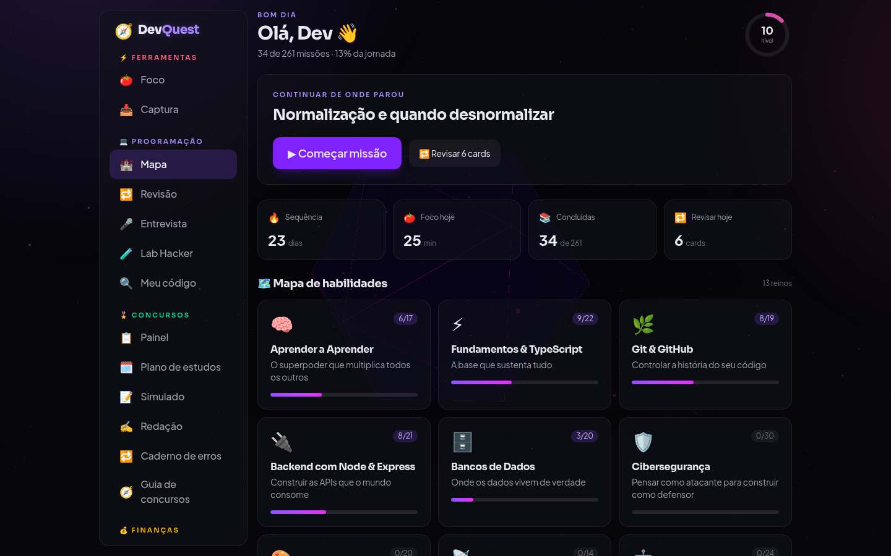

---

## 💡 O problema que ele resolve

Cursos genéricos ensinam com exemplos que você nunca mais vê. Eu queria o contrário: **aprender um conceito e na mesma hora ver onde ele aparece no código que eu mesmo escrevi**. Também queria revisar o conteúdo sem esquecer e manter a constância nos dias ruins.

O DevQuest junta isso num lugar só:

- 📚 **891 aulas em 63 trilhas** (programação, concursos públicos, finanças, disciplina e comunicação), em 3 níveis de dificuldade e com um "chefão" no fim de cada nível
- 🔁 **Revisão espaçada** (1 → 3 → 7 → 14 → 30 dias): todo conceito estudado vira um card
- 🤖 **IA como professora**: gera aulas sob demanda, corrige exercícios, conduz entrevistas simuladas e explica arquivos do meu código
- 🎮 **Gamificação**: XP, níveis, sequência de dias e mapa de habilidades

---

## ✨ Destaques

### 1. Método de aula baseado em ciência da aprendizagem
Cada missão de cerca de 25 minutos segue o mesmo ciclo: **Gancho → Conceito → No seu código → Prática corrigida pela IA → Ensine de volta (técnica Feynman) → Quiz**.
A etapa "No seu código" abre um trecho real de um dos meus projetos (FinanceFlow, Speak AI, LifeQuest…) para ligar a teoria ao que eu já construí.

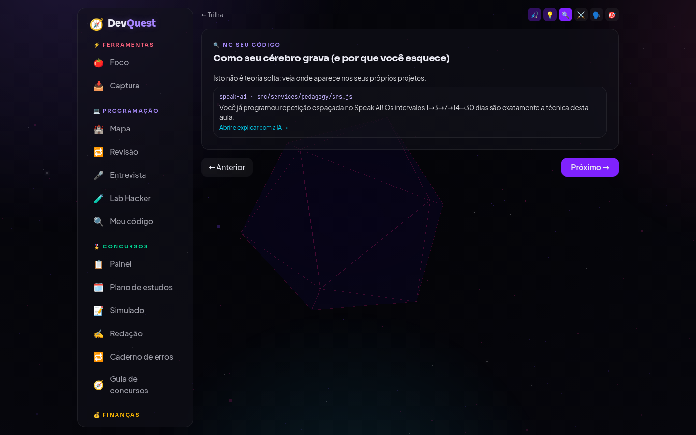

### 2. 🧪 Laboratório Hacker: segurança ofensiva para aprender a defender
São 7 laboratórios baseados no **OWASP Top 10**: SQL Injection, IDOR, XSS, Path Traversal, JWT fraco, força bruta vs. rate limit e quebra de senha.
Cada ataque roda **lado a lado contra a versão vulnerável e a versão segura** do mesmo código, num **SQLite em memória criado e destruído a cada requisição**, com dados falsos e flags. Nada toca o sistema real. Depois de explorar a falha, eu escrevo a correção e a IA avalia.

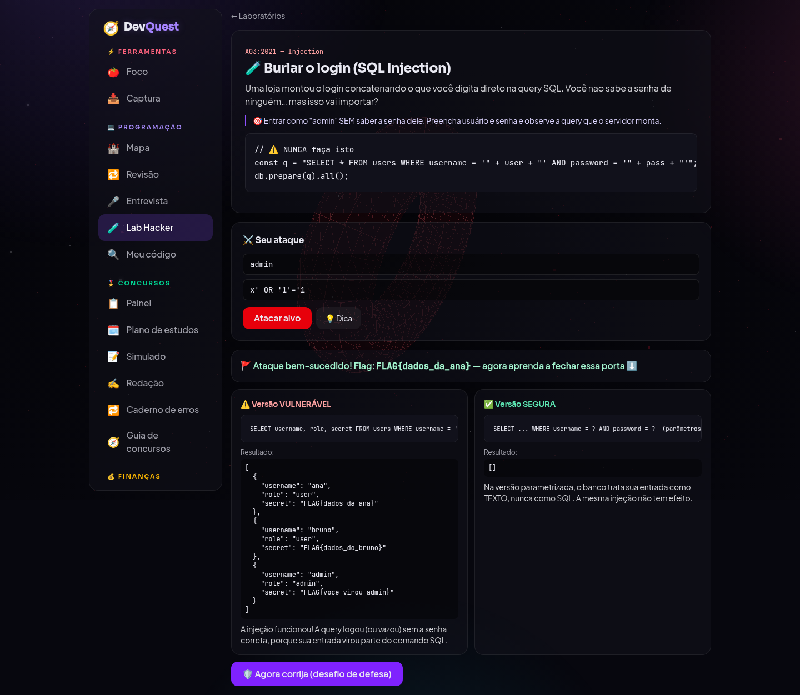

### 3. 🎤 Modo Entrevista
É um entrevistador de IA com 5 personas: Tech Lead, Sênior exigente, especialista em segurança, recrutador em **inglês** e RH comportamental (método STAR). Dá para escolher o nível (júnior, pleno ou sênior) e o assunto. No fim, a IA dá uma nota e diz o que melhorar.

| Entrevista | Revisão espaçada |
|---|---|
| 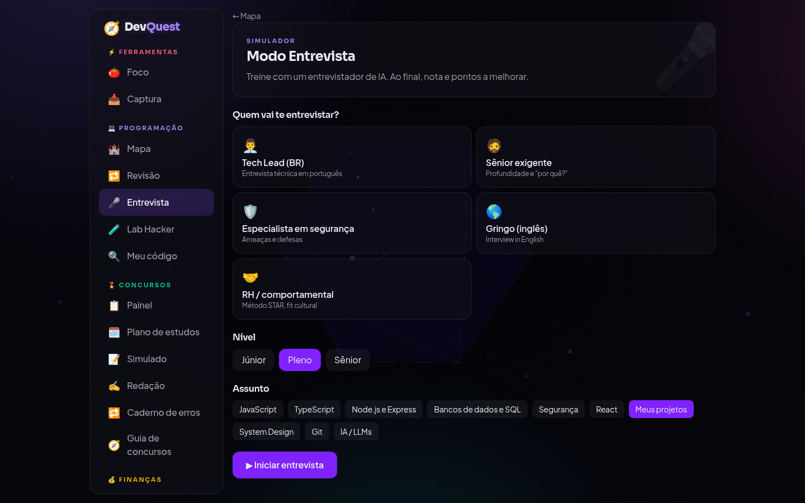 | 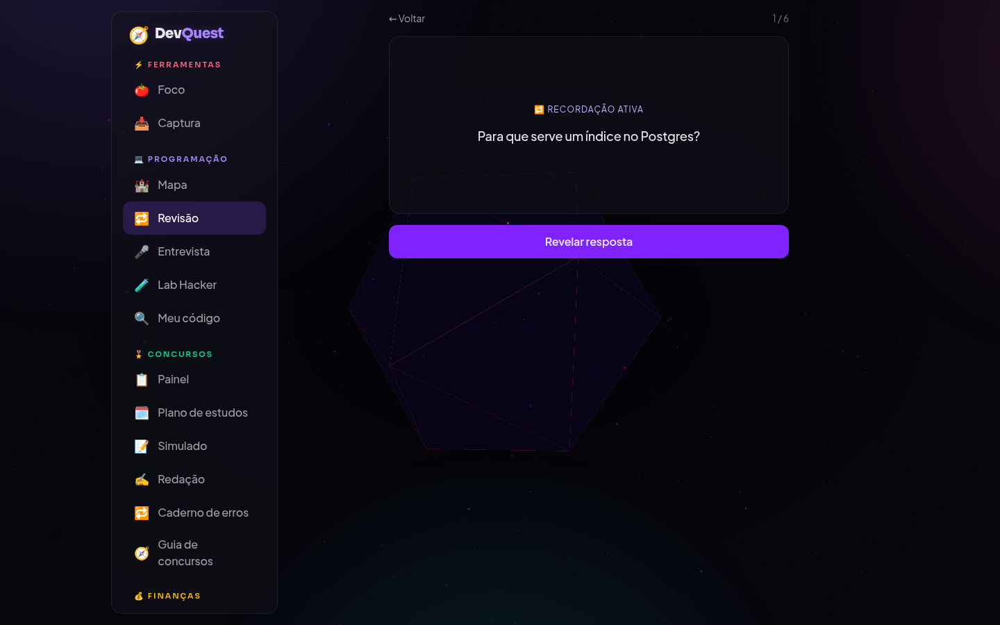 |

### 4. 🎖️ Modo Concurso
É uma trilha separada para concursos públicos de nível médio: 21 matérias e cerca de 300 aulas. Tem simulados gerados no estilo de cada banca (o gabarito fica só no servidor), desempenho por matéria, plano de estudos, correção de redação pelos critérios das bancas e um guia de carreiras.

| Painel de desempenho | Guia de carreiras |
|---|---|
| 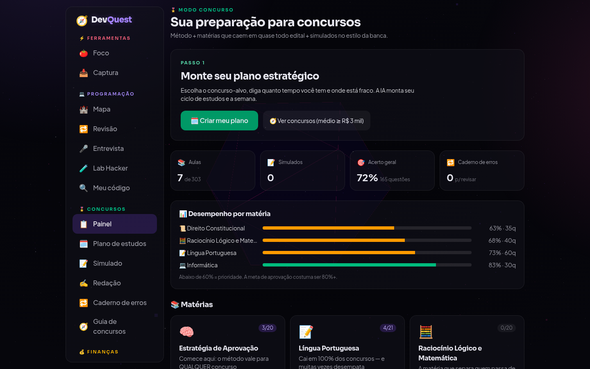 | 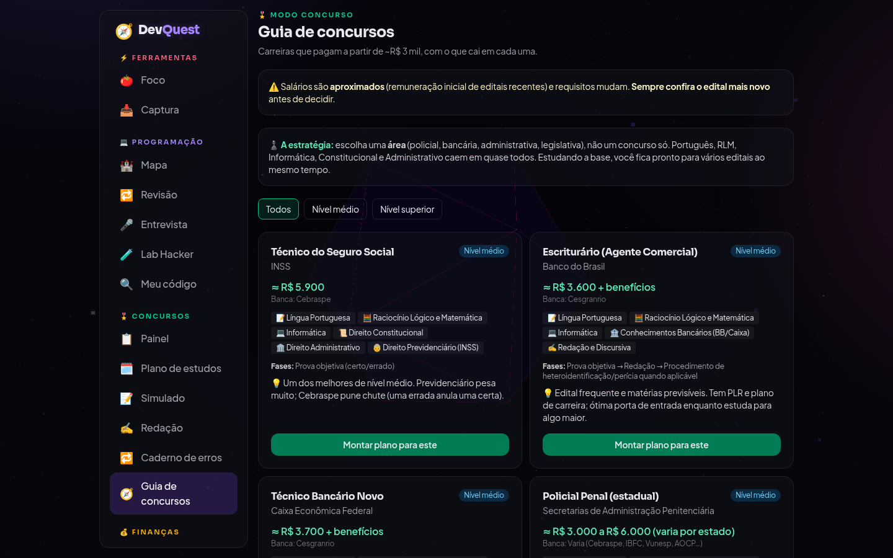 |

### 5. 💰 Finanças com dados ao vivo
São 17 trilhas e uma biblioteca de 26 livros clássicos com resumo gerado pela IA. Há **17 calculadoras que rodam no navegador** (CDB x LCI, IR e IOF, SAC x Price, alugar x comprar…), alimentadas por **indicadores reais do Banco Central** (CDI, Selic, IPCA, PTAX) com cache de 1 hora.

| Calculadoras | Biblioteca |
|---|---|
| 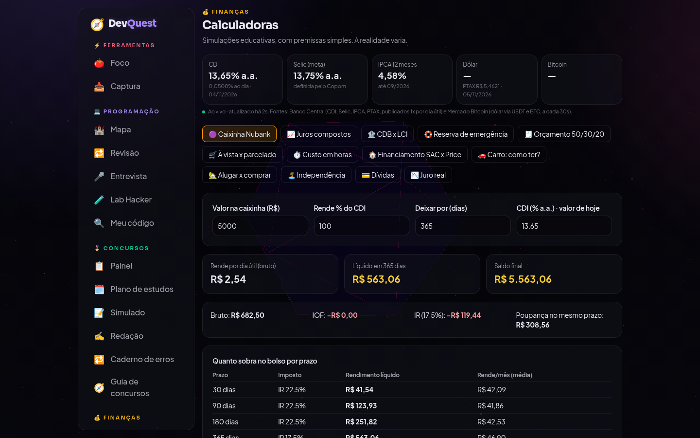 | 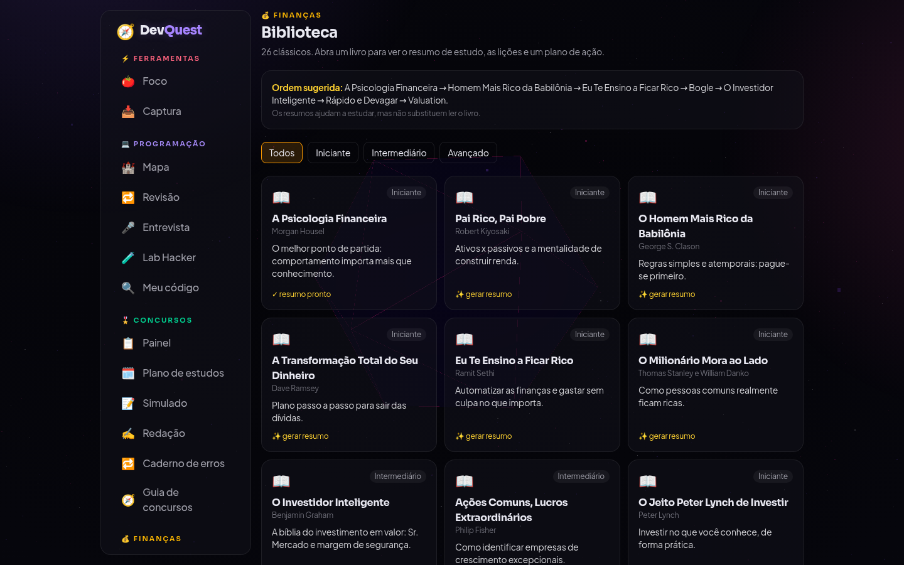 |

### 6. 🔥 Disciplina e Foco
Tem um check-in diário com duas opções, "fiz o mínimo" ou "fiz completo", porque um dia ruim não deve zerar a sequência. A IA monta um protocolo anti-desistência e há um botão 🆘 para os dias difíceis. O Pomodoro registra horas líquidas por matéria.

| Disciplina | Foco |
|---|---|
| 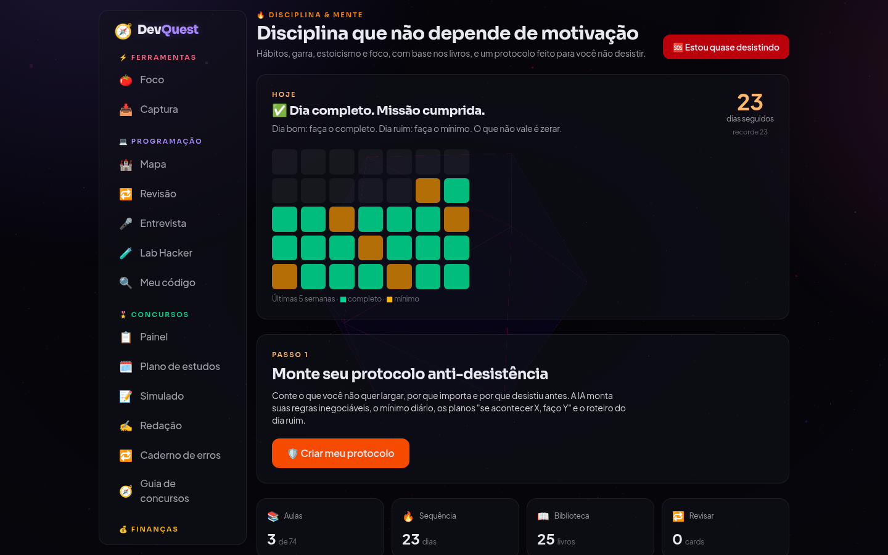 | 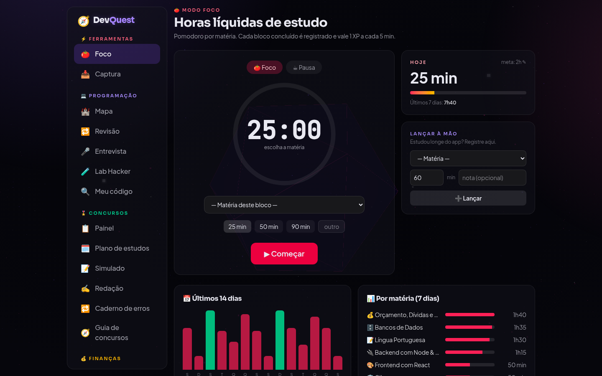 |

### 7. 📱 Instalável no celular (PWA)
No celular, a navegação vai para abas na parte de baixo e um menu em gaveta, e dá para instalar o app como se fosse nativo.

<p align="center">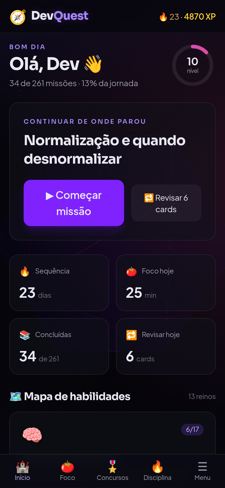</p>

---

## 🏗️ Arquitetura

É um monorepo **100% TypeScript** com npm workspaces. Os tipos e as validações ficam num pacote compartilhado, então **front e back usam o mesmo contrato**.

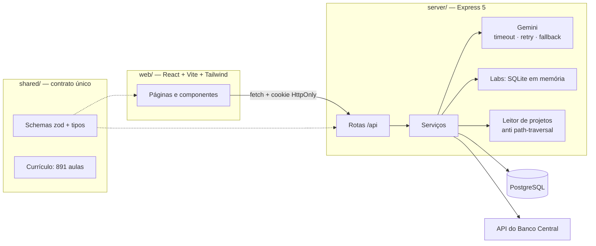

```
shared/   tipos, schemas zod e todo o currículo (aulas, níveis, livros, carreiras)
server/   API Express: auth, aulas, revisão, labs, concursos, finanças, foco…
web/      SPA React com páginas por trilha, PWA e cena 3D (three.js)
```

## 🔐 Segurança (aplicando o que o próprio app ensina)

| Ameaça | Defesa |
|---|---|
| Roubo de sessão por XSS | JWT em **cookie `HttpOnly` + `SameSite`**, nunca no `localStorage` |
| Senhas vazadas | **bcrypt com custo 12** |
| Força bruta | **Rate limit** separado para login, setup e API |
| Entrada maliciosa | Toda entrada validada com **zod** e **queries parametrizadas** no Postgres |
| Leitura de arquivos indevida | O leitor de projetos **bloqueia path traversal**, `node_modules` e `.env` |
| SSRF na captura de links | Trava que **bloqueia IPs internos e privados** antes de buscar uma URL |
| Cola nos simulados | **O gabarito nunca vai para o navegador**: a correção é feita no servidor |
| Headers inseguros | **helmet** no Express e CSP no proxy reverso |
| Banco com acesso amplo | Usuário do Postgres com **privilégio mínimo**, só no próprio database |

## 🤖 IA robusta, não só "chamar a API"

- **Timeout, retentativa e fallback** automático entre modelos quando um falha ou fica sem cota
- **Extração defensiva de JSON** das respostas do modelo, validada antes de usar
- **Cache** de aulas e resumos de livros no banco, para não pagar duas vezes pelo mesmo conteúdo
- O app **funciona sem chave de IA**: só os recursos de IA ficam desligados

## 🚀 Como rodar

Requisitos: Node 20+ e PostgreSQL.

```bash
git clone https://github.com/Mhsilva-dev/devquest-showcase.git
cd devquest-showcase
npm install
cp .env.example .env            # preencha DATABASE_URL, JWT_SECRET e SETUP_CODE
npm -w web run build            # builda o front (servido pelo próprio Express)
npm start                       # http://127.0.0.1:3030
```

O schema do banco é aplicado automaticamente na subida. No primeiro acesso, a tela pede o `SETUP_CODE` do `.env` e cria a conta de administrador. Para ligar a IA, coloque a sua `GEMINI_API_KEY` no `.env`.

Em produção eu rodo com **PM2** (`ecosystem.config.cjs`) atrás de um **nginx** com HTTPS (Let's Encrypt).

---

## 👨‍💻 Autor

**Matheus Henrique Fonseca Silva**. Este é um projeto pessoal de estudo, publicado como portfólio.
Veja também meus outros projetos no [meu perfil do GitHub](https://github.com/Mhsilva-dev).
